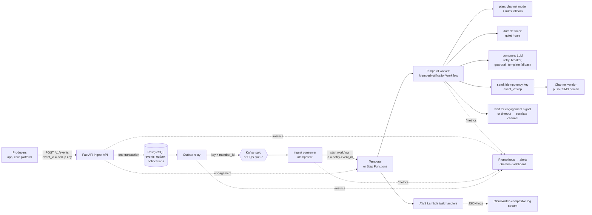

# notify-flow

[](https://github.com/AyushGupta-Code/notify-flow/actions/workflows/ci.yml)

An event-driven member-notification service for a fictional digital MSK (musculoskeletal)
care program. It decides **what** message a member gets, **when** (outside their quiet
hours), and on **which channel**, then follows up on a second channel if they don't engage.

All member data is synthetic. The code still treats it as PHI: logs are PII-redacted, the
LLM never sees a direct identifier, and clinically sensitive messages are never generated by
a model.



## What it demonstrates

| Area | Where |
|---|---|
| Backend APIs | `src/notify_flow/api/app.py`: event ingest, engagement callback, admin endpoints, health/readiness, metrics |
| Event-driven, queues | Transactional outbox (`relay.py`) → Kafka (`queue/kafka.py`, idempotent producer, manual commits) or SQS (`queue/sqs.py`, DLQ redrive) |
| Workflow orchestration, long-running state | Temporal workflow (`workflows/notification.py`): durable quiet-hours timer, engagement signal with a 48 h timeout, channel escalation. Step Functions twin: `aws/stepfunctions/notification.asl.json` |
| Idempotency, exactly-once effect | Dedup at the API (`event_id` PK), the consumer (`processed_events` + deterministic workflow ID with `REJECT_DUPLICATE`), and the send (unique `event_id:step` key, row lock, vendor idempotency key) |
| LLM in a product workflow | `llm/`: provider interface (mock, Ollama, Anthropic), timeout + retry with backoff and jitter + circuit breaker, runtime guardrail, versioned template fallback, versioned prompt registry |
| ML model serving | `channel/policy.py`: logistic-regression channel model served from JSON weights, rule-based fallback, model version recorded on every notification |
| Evaluation | `evals/`: rubric, synthetic cases, known-bad set that tests the checker itself; runs in CI |
| Observability | JSON logs with correlation IDs and PII redaction, Prometheus metrics, 7 alert rules with promtool unit tests, provisioned Grafana dashboard, `docs/RUNBOOK.md`, an incident drill write-up |
| Deployment | Dockerfile, docker-compose, Kubernetes (kustomize) with a kind overlay, GitHub Actions CI |

## Design decisions and tradeoffs

- **Outbox instead of publishing from the request.** The API writes the event and an outbox
  row in one Postgres transaction and returns. A relay publishes later. The API never
  acknowledges an event it could lose, and a broker outage only grows the outbox. Cost:
  extra latency (relay poll interval) and a table to vacuum.
- **Dedup in three places, because each catches different duplicates.** The API catches
  producer retries. The consumer's `processed_events` check plus Temporal's workflow-ID
  uniqueness catches queue redelivery (including the crash window between starting a
  workflow and recording it, because the consumer *starts first, records second*). The send
  activity's unique key plus the vendor idempotency key catches activity retries, including
  "vendor accepted the message, then we crashed before recording it" (tested).
- **The send holds a row lock across the vendor call.** That serializes concurrent retries of
  the same key so they can't double-send, at the price of one DB connection held for the
  duration of a vendor call. At higher volume I would switch to a lease column.
- **Quiet hours are computed inside the workflow from `workflow.now()`**, not in an
  activity. The first version computed the wait in an activity using wall-clock time; the
  integration tests exposed that this disagrees with the workflow's clock, so the timer
  could fire at the wrong moment after a replay. Moving it into the workflow makes it
  deterministic.
- **The LLM never fails a workflow.** The compose activity always returns copy: LLM output
  that passes the guardrail, or the versioned template. A breaker stops hammering a dead
  provider. `pain_checkin` is template-only by policy (`llm_allowed: false`), because
  clinical messaging should be reviewed copy, not generated copy.
- **PII minimization by construction.** Prompts include only the fields the prompt version
  whitelists (`context_fields`). The model writes `{first_name}` as a placeholder; the name is
  filled in at send time, so it is never in the prompt, the model output, or Temporal's
  workflow history. Logs redact sensitive keys and email/phone/SSN/date patterns.
- **Every notification is reproducible.** Each row stores `prompt_version`, `llm_model`,
  `template_version`, `copy_source`/`copy_reason`, `channel_model_version` and
  `decision_source`, so any message can be traced back to the exact prompt and model.
- **Channel model as JSON weights, served with plain Python.** No pickle and no scikit-learn
  at runtime. If the model file is missing or produces a bad score, the rule-based policy
  takes over and the decision is labeled `rules`.
- **Kafka is consumed sequentially per partition; SQS concurrently.** Kafka is keyed by
  `member_id` so one member's events stay ordered. SQS standard queues are unordered anyway,
  so the SQS consumer handles batches and several poll loops concurrently.
- **Pluggable transport and orchestrator** (`NF_QUEUE_BACKEND=kafka|sqs`,
  `NF_ORCHESTRATOR=temporal|stepfunctions`). Temporal is the primary path. The AWS path
  exists to show the same design on managed services; it is less complete (below).

## Running it

### With Docker (what CI runs)

```bash
cp .env.example .env            # optional; defaults work
docker compose up --build       # Postgres, Kafka, Temporal (+UI :8080), api :8000, relay,
                                # consumer, worker, Prometheus :9090, Grafana :3000
python scripts/smoke_test.py --api http://localhost:8000
```

Set `NF_ENGAGEMENT_WAIT_S=5 NF_QUIET_HOURS_ENABLED=false` to see escalation within seconds.
`docker compose --profile aws up` adds LocalStack (see "Verified vs untested").

### Kubernetes (kind)

```bash
kind create cluster --name nf
docker build -t notify-flow:ci . && kind load docker-image notify-flow:ci --name nf
kubectl apply -k deploy/k8s/overlays/kind
kubectl -n notify-flow port-forward svc/notify-flow-api 8000:80
python scripts/smoke_test.py --api http://localhost:8000 --expect-escalation
```

`deploy/k8s/base` is the app (API with readiness/liveness probes and a PDB, relay, consumer,
worker, migration Job, non-root, read-only root filesystem). `deploy/k8s/deps` holds
throwaway Postgres/Kafka/Temporal for kind only.

### Without Docker

The development machine for this project had no Docker, so there is a docker-free path:

```bash
uv venv -p 3.12 && uv pip install -e '.[dev]'
# Postgres on :5433 with databases notify_flow and notify_flow_test (any install works)
python scripts/local_temporal.py --port 7233 --db ""   # Temporal dev server via the SDK
NF_SQS_POLLERS=4 scripts/run_local_stack.sh start        # moto (SQS), fake Ollama, api, relay, consumer, worker
python scripts/smoke_test.py --expect-escalation
scripts/run_local_stack.sh stop
```

### Tests, eval, model

```bash
pytest                                   # unit + integration (Postgres, Temporal test server, moto)
NF_KAFKA_BOOTSTRAP=localhost:9092 pytest # also runs the Kafka test
python -m evals.run_eval                 # offline copy eval (mock provider by default)
python scripts/train_channel_model.py    # regenerate models/channel_lr_v1.json
```

Use a real model with `NF_LLM_PROVIDER=ollama NF_LLM_MODEL=<model>` or
`NF_LLM_PROVIDER=anthropic NF_ANTHROPIC_API_KEY=...`, and score it with
`python -m evals.run_eval --provider ollama --model <model>`.

## Measured numbers

Everything below was produced by a command in this repo. Nothing is extrapolated.

**Tests.** 54 tests: 38 unit + 16 integration. Locally 53 pass and the Kafka test is
skipped (no broker on the dev machine); in CI all 54 pass, including Kafka.
`pytest` / CI job `test`.

**Eval** (`python -m evals.run_eval`, mock provider):
33/33 LLM-eligible messages pass the rubric (3 more are template-only by policy), and the
checker catches 17/17 known-bad samples with 0/3 false positives on known-good samples.
The 100% pass rate only shows the pipeline (whitelisting, prompt assembly, scoring) works
end to end. The mock provider writes compliant copy by construction, so it says nothing about a real
model's quality. Run the same harness with `--provider ollama|anthropic` for that.

**Channel model** (`python scripts/train_channel_model.py`, seed 42, 20,000 synthetic rows
per channel, 25% held out): held-out AUC push 0.706, SMS 0.679, email 0.650. The data comes
from a known logistic function plus noise, so this measures whether the training pipeline
recovers it, not real member behaviour.

**Load test** (`scripts/load_test.py --events 500 --members 100 --concurrency 20`, plus 50
duplicate posts; docker-free stack on an 8-core WSL2 laptop: uvicorn with 2 workers, moto as
SQS, Temporal dev server, fake LLM with 150 ms latency, 20 s engagement window so each event
also escalates). Raw JSON is in `docs/incidents/data/`.

| Configuration | All 500 step-1 sends done | Event→send p50 / p95 | API ingest |
|---|---|---|---|
| Sequential SQS consumer, Temporal dev server on SQLite file | 171 s (from DB timestamps; consumer alone took 115 s) | n/a (script crashed on output; fixed) | 500 events accepted in 2.7 s |
| 4 concurrent SQS pollers, Temporal on SQLite file | 135.2 s | 83.4 s / 128.1 s | 186 posts/s, p50 78 ms, p95 252 ms |
| 4 pollers, Temporal in-memory, 1 worker | **18.0 s (27.8 events/s)** | **10.6 s / 14.8 s** | 128 posts/s, p50 117 ms, p95 382 ms |
| 4 pollers, Temporal in-memory, 3 workers | 21.1 s | 12.6 s / 16.8 s | 127 posts/s, p50 125 ms, p95 332 ms |

In every run, 50 of 550 posts were rejected as duplicates and the vendor received exactly 500
step-1 deliveries. How I read these: the consumer change was a real fix (consume time
115 s → 19.8 s). The jump from 135 s to 18 s came from the Temporal dev server's SQLite
persistence on this machine: workflow tasks waited up to 96 s to be picked up while
activities started instantly. That is a property of the local dev server, not of the
service, and a production Temporal cluster has a different profile. Adding workers did not
help here, so the next bottleneck on this machine is somewhere in the single-process dev
server or consumer. I did not dig further.

**LLM-outage drill** ([postmortem](docs/incidents/2026-11-24-llm-outage-drill.md)): 4
events/s for 331 s with the LLM killed for 180 s. 1,277/1,277 step-1 messages sent, 0 send
failures; 697 sent during the outage, all from fallback templates. Breaker open 2.2 s after
the kill, closed 2.9 s after the restore. Event→send p50 was 0.39 s at baseline and 0.26 s
during the outage.

**CI** (GitHub Actions): lint + mypy, tests with Postgres and Kafka service containers, eval,
promtool rule tests (synthetic and drill replay), docker-compose smoke test (end to end with
duplicate rejection and escalation, Prometheus scraping all 4 components, Grafana dashboard
provisioned), and a kind deploy with the same smoke test running through the cluster.

## Verified vs untested

| Component | Status |
|---|---|
| FastAPI, outbox, Postgres, Alembic migration (up/down) | Verified: tests, local stack, compose and kind in CI |
| Temporal workflow (timers, signals, escalation, retries) | Verified: Temporal test server in tests; dev server locally; Temporal `auto-setup` in compose and kind (CI) |
| Kafka adapter | Verified in CI only (test with a real broker, plus the compose and kind smoke tests). No broker on the dev machine. |
| SQS adapter | Verified against **moto** (tests and the local stack's load test and drill). **Not run against real AWS or LocalStack.** |
| Step Functions adapter + ASL | Verified in LocalStack CI: six Lambda handlers, retry/catch paths, duplicate starts, quiet-hours and engagement waits, fallback copy, and idempotent sends. Moto also verifies definition registration. Not run on real AWS. |
| LocalStack | Deployment plus real Step Functions and Lambda executions are verified in the `stepfunctions-localstack` CI job. |
| Ollama provider | Exercised against `scripts/fake_ollama.py` (Ollama's API shape), **not a real Ollama model.** |
| Anthropic provider | **Untested** (no API key used). |
| Docker images, docker-compose | Verified in CI (no Docker on the dev machine) |
| Kubernetes manifests | Verified on kind in CI: rollouts, migration Job, end-to-end smoke test. Not tested on EKS or any managed cluster. |
| Prometheus alerts | `promtool check` and rule unit tests in CI, including a replay of the drill's measured metrics. Alertmanager routing is not configured. |
| Grafana dashboard | Provisioning verified in CI (dashboard loads, 14 panels). Panels were not visually reviewed under load. |
| Airflow | **Skipped.** A nightly retrain-and-eval DAG would be the natural fit, but it was out of scope. |

## Open gaps

- No real on-call experience: the runbook and postmortem come from a drill on a laptop.
- No real model evaluated: the eval ran only against the mock provider.
- Real AWS remains untested; the executable path is verified against LocalStack.
- The channel model is trained on synthetic data. The model-vs-rules experiment and live
  engagement report are implemented, but no real member traffic has been evaluated.
- No HIPAA controls beyond data minimization and log redaction (no encryption-at-rest
  configuration, audit log, or BAA-covered LLM provider).

## Layout

```
src/notify_flow/   api/ (FastAPI)  workflows/ (Temporal workflow + activities)
                   queue/ (Kafka, SQS)  orchestrator/ (Temporal, Step Functions)
                   llm/ (providers, resilience, registry, guardrails, personalize)
                   channel/ (model + rules)  ingest.py  relay.py  sender.py  log.py  metrics.py
prompts/registry.yaml   models/channel_lr_v1.json   migrations/   aws/stepfunctions/
evals/              tests/unit  tests/integration   scripts/ (train, load test, drill, local stack)
deploy/ (k8s, prometheus, grafana)   docs/ (RUNBOOK.md, incidents/)
```
