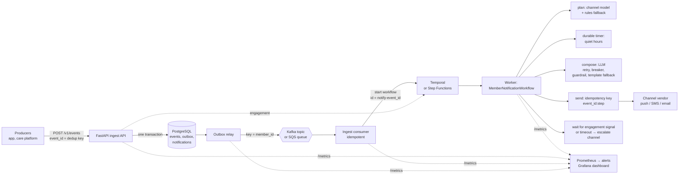

# notify-flow

An event-driven member-notification service for a fictional digital MSK (musculoskeletal)
care program. It decides **what** message a member gets, **when** (outside their quiet
hours), and on **which channel**, then follows up on a second channel if they don't engage.

All member data is synthetic. The code still treats it as PHI: logs are PII-redacted, the
LLM never sees a direct identifier, and clinically sensitive messages are never generated by
a model.



## What it demonstrates

| Area | Where |
|---|---|
| Backend APIs | `src/notify_flow/api/app.py`: event ingest, engagement callback, admin endpoints, health/readiness, metrics |
| Event-driven, queues | Transactional outbox (`relay.py`) → Kafka (`queue/kafka.py`, idempotent producer, manual commits) or SQS (`queue/sqs.py`, DLQ redrive) |
| Workflow orchestration, long-running state | Temporal workflow (`workflows/notification.py`): durable quiet-hours timer, engagement signal with a 48 h timeout, channel escalation. Step Functions twin: `aws/stepfunctions/notification.asl.json` |
| Idempotency, exactly-once effect | Dedup at the API (`event_id` PK), the consumer (`processed_events` + deterministic workflow ID with `REJECT_DUPLICATE`), and the send (unique `event_id:step` key, row lock, vendor idempotency key) |
| LLM in a product workflow | `llm/`: provider interface (mock, Ollama, Anthropic), timeout + retry with backoff and jitter + circuit breaker, runtime guardrail, versioned template fallback, versioned prompt registry |
| ML model serving | `channel/policy.py`: logistic-regression channel model served from JSON weights, rule-based fallback, model version recorded on every notification |
| Evaluation | `evals/`: rubric, synthetic cases, known-bad set that tests the checker itself; runs in CI |
| Observability | JSON logs with correlation IDs and PII redaction, Prometheus metrics, 7 alert rules with promtool unit tests, provisioned Grafana dashboard, `docs/RUNBOOK.md`, an incident drill write-up |
| Deployment | Dockerfile, docker-compose, Kubernetes (kustomize) with a kind overlay, GitHub Actions CI |

## Design decisions and tradeoffs

- **Outbox instead of publishing from the request.** The API writes the event and an outbox
  row in one Postgres transaction and returns. A relay publishes later. The API never
  acknowledges an event it could lose, and a broker outage only grows the outbox. Cost:
  extra latency (relay poll interval) and a table to vacuum.
- **Dedup in three places, because each catches different duplicates.** The API catches
  producer retries. The consumer's `processed_events` check plus Temporal's workflow-ID
  uniqueness catches queue redelivery (including the crash window between starting a
  workflow and recording it, because the consumer *starts first, records second*). The send
  activity's unique key plus the vendor idempotency key catches activity retries, including
  "vendor accepted the message, then we crashed before recording it" (tested).
- **The send holds a row lock across the vendor call.** That serializes concurrent retries of
  the same key so they can't double-send, at the price of one DB connection held for the
  duration of a vendor call. At higher volume I would switch to a lease column.
- **Quiet hours are computed inside the workflow from `workflow.now()`**, not in an
  activity. The first version computed the wait in an activity using wall-clock time; the
  integration tests exposed that this disagrees with the workflow's clock, so the timer
  could fire at the wrong moment after a replay. Moving it into the workflow makes it
  deterministic.
- **The LLM never fails a workflow.** The compose activity always returns copy: LLM output
  that passes the guardrail, or the versioned template. A breaker stops hammering a dead
  provider. `pain_checkin` is template-only by policy (`llm_allowed: false`), because
  clinical messaging should be reviewed copy, not generated copy.
- **PII minimization by construction.** Prompts include only the fields the prompt version
  whitelists (`context_fields`). The model writes `{first_name}` as a placeholder; the name is
  filled in at send time, so it is never in the prompt, the model output, or Temporal's
  workflow history. Logs redact sensitive keys and email/phone/SSN/date patterns.
- **Every notification is reproducible.** Each row stores `prompt_version`, `llm_model`,
  `template_version`, `copy_source`/`copy_reason`, `channel_model_version` and
  `decision_source`, so any message can be traced back to the exact prompt and model.
- **Channel model as JSON weights, served with plain Python.** No pickle and no scikit-learn
  at runtime. If the model file is missing or produces a bad score, the rule-based policy
  takes over and the decision is labeled `rules`.
- **Kafka is consumed sequentially per partition; SQS concurrently.** Kafka is keyed by
  `member_id` so one member's events stay ordered. SQS standard queues are unordered anyway,
  so the SQS consumer handles batches and several poll loops concurrently.
- **Pluggable transport and orchestrator** (`NF_QUEUE_BACKEND=kafka|sqs`,
  `NF_ORCHESTRATOR=temporal|stepfunctions`). Temporal is the primary path. The AWS path
  exists to show the same design on managed services; it is less complete (below).

## Running it

### With Docker (what CI runs)

```bash
cp .env.example .env            # optional; defaults work
docker compose up --build       # Postgres, Kafka, Temporal (+UI :8080), api :8000, relay,
                                # consumer, worker, Prometheus :9090, Grafana :3000
python scripts/smoke_test.py --api http://localhost:8000
```

Set `NF_ENGAGEMENT_WAIT_S=5 NF_QUIET_HOURS_ENABLED=false` to see escalation within seconds.
`docker compose --profile aws up` adds LocalStack (see "Verified vs untested").

### Kubernetes (kind)

```bash
kind create cluster --name nf
docker build -t notify-flow:ci . && kind load docker-image notify-flow:ci --name nf
kubectl apply -k deploy/k8s/overlays/kind
kubectl -n notify-flow port-forward svc/notify-flow-api 8000:80
python scripts/smoke_test.py --api http://localhost:8000 --expect-escalation
```

`deploy/k8s/base` is the app (API with readiness/liveness probes and a PDB, relay, consumer,
worker, migration Job, non-root, read-only root filesystem). `deploy/k8s/deps` holds
throwaway Postgres/Kafka/Temporal for kind only.

### Without Docker

The development machine for this project had no Docker, so there is a docker-free path:

```bash
uv venv -p 3.12 && uv pip install -e '.[dev]'
# Postgres on :5433 with databases notify_flow and notify_flow_test (any install works)
python scripts/local_temporal.py --port 7233 --db ""   # Temporal dev server via the SDK
NF_SQS_POLLERS=4 scripts/run_local_stack.sh start        # moto (SQS), fake Ollama, api, relay, consumer, worker
python scripts/smoke_test.py --expect-escalation
scripts/run_local_stack.sh stop
```

### Tests, eval, model

```bash
pytest                                   # unit + integration (Postgres, Temporal test server, moto)
NF_KAFKA_BOOTSTRAP=localhost:9092 pytest # also runs the Kafka test
python -m evals.run_eval                 # offline copy eval (mock provider by default)
python scripts/train_channel_model.py    # regenerate models/channel_lr_v1.json
```

Use a real model with `NF_LLM_PROVIDER=ollama NF_LLM_MODEL=<model>` or
`NF_LLM_PROVIDER=anthropic NF_ANTHROPIC_API_KEY=...`, and score it with
`python -m evals.run_eval --provider ollama --model <model>`.
